# Diagramas del sistema

Diagramas de análisis y diseño hechos a partir del sistema actual: modelos, migraciones, rutas y servicios. Están en Mermaid para que se versionen con el código: GitHub los dibuja al abrir este archivo y el generador de PDF los incluye. Reemplazan a los diagramas PNG del entregable original, que eran anteriores al modelo definitivo.

## 1. Contexto del sistema

Quién usa el sistema y con qué se integra.

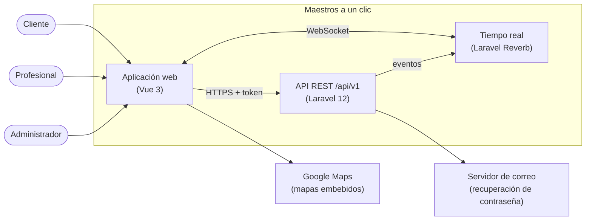

## 2. Casos de uso

Un diagrama por actor. Las historias que cubre cada caso están en [02-requisitos.md](02-requisitos.md).

### 2.1 Cliente

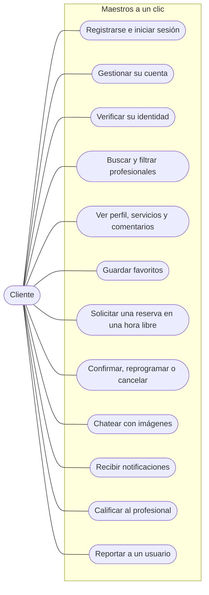

### 2.2 Profesional

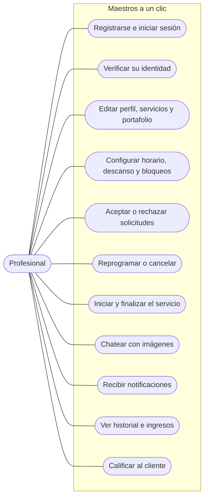

### 2.3 Administrador y sistema

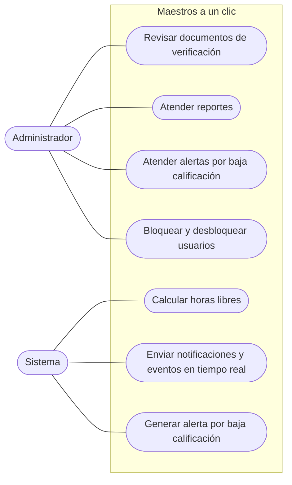

## 3. Clases del dominio

Modelos principales con sus atributos clave y los servicios que aplican las reglas de negocio. Los estados, roles y tipos son enumeraciones de PHP (`app/Enums`).

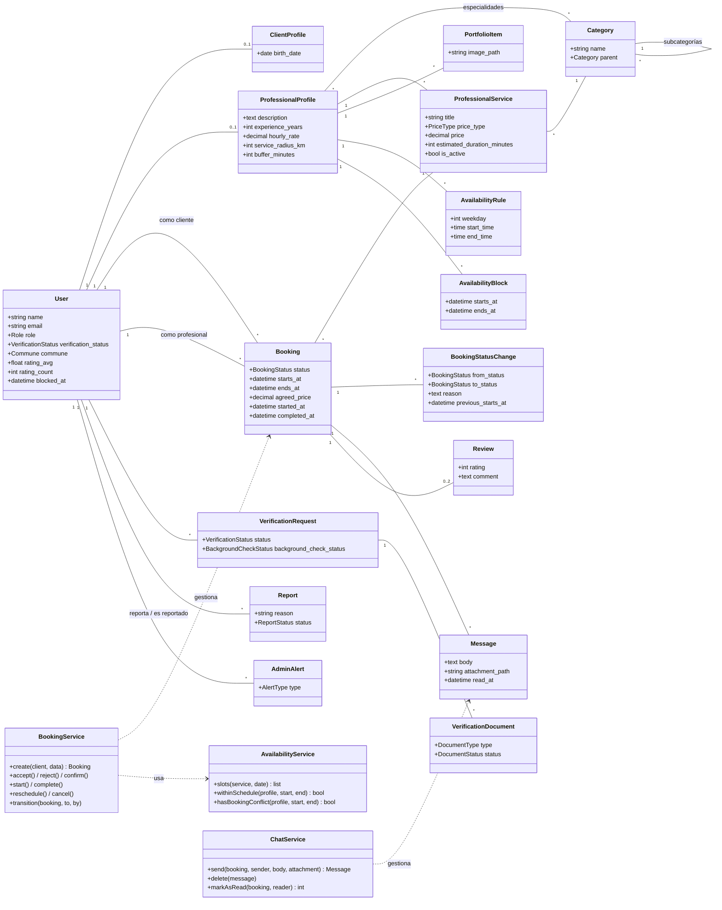

## 4. Modelo entidad-relación

Entidades y relaciones con sus llaves. Las columnas completas de cada tabla están en [docs/modelo-de-datos.md](../modelo-de-datos.md) §2.

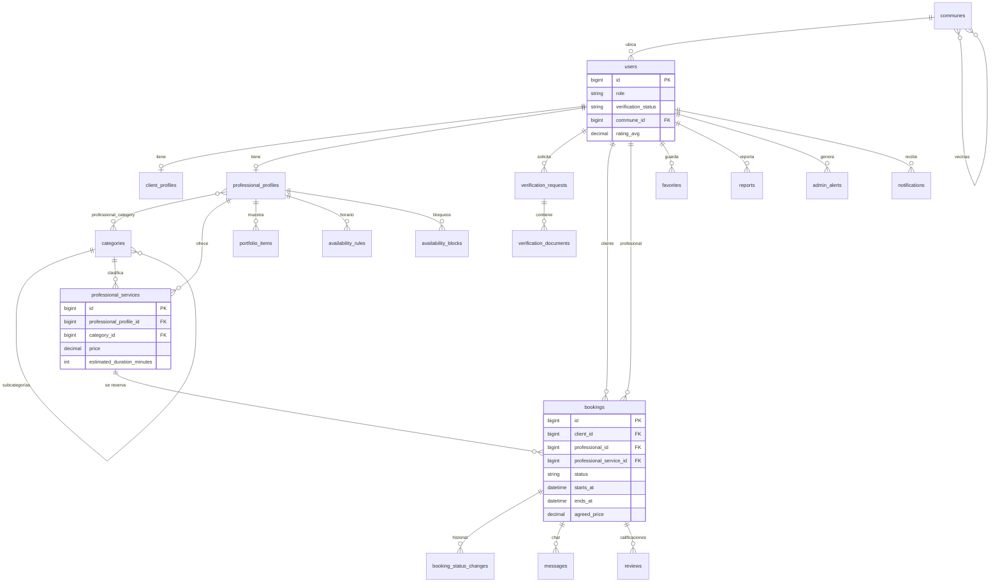

## 5. Estados

### 5.1 Reserva

Todo cambio pasa por `BookingService::transition()` y queda en `booking_status_changes`.

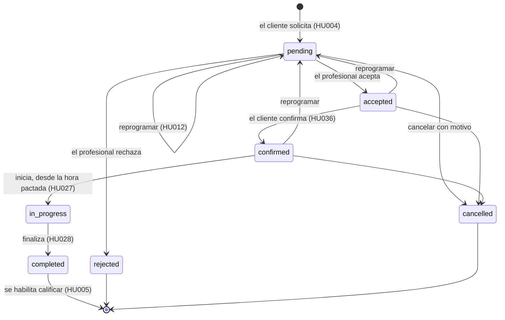

### 5.2 Verificación de identidad

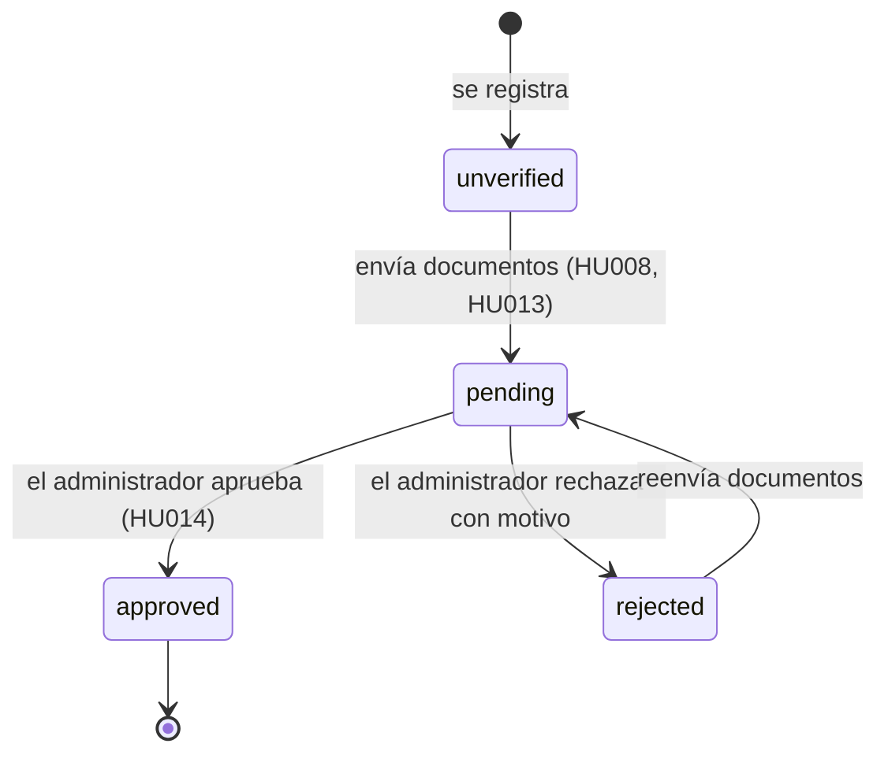

## 6. Secuencias

### 6.1 Solicitar y aceptar una reserva

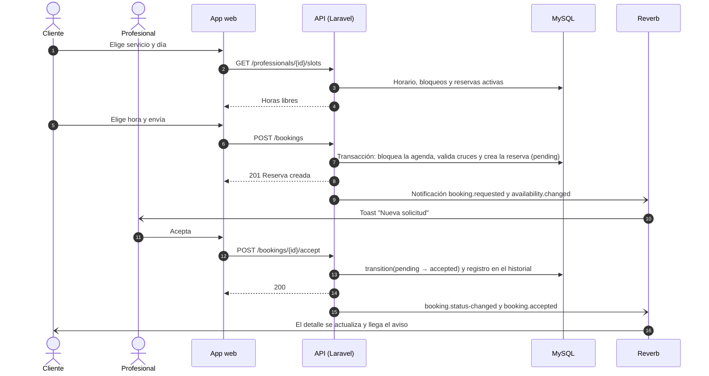

### 6.2 Mensaje en el chat

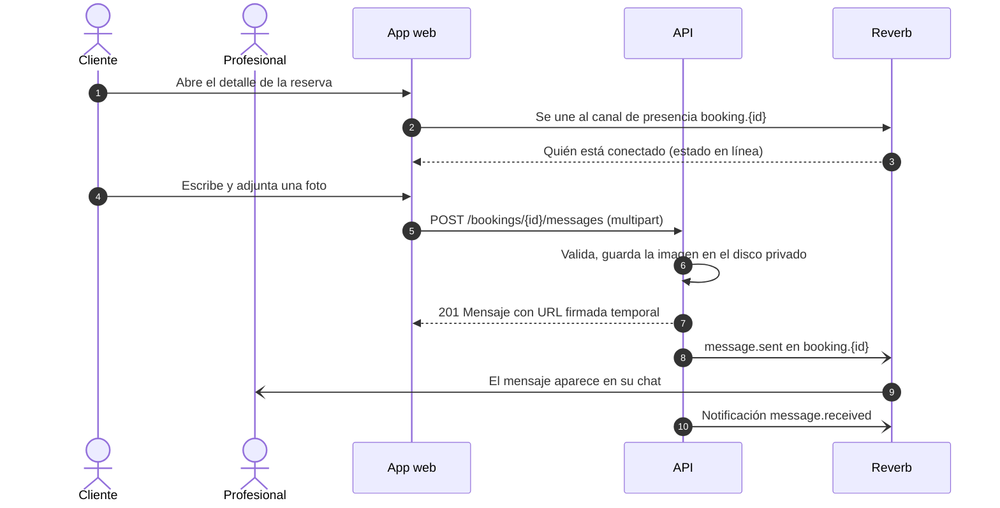

## 7. Componentes

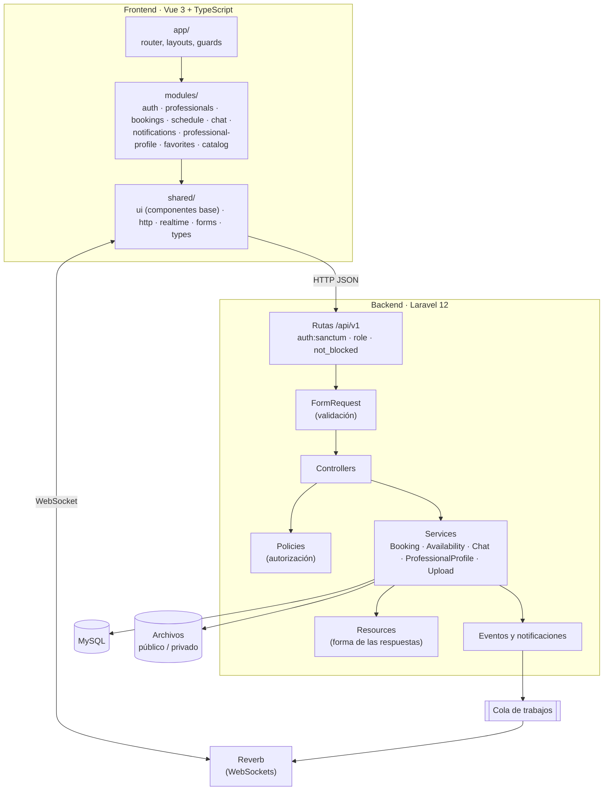

## 8. Despliegue

Topología prevista para producción. Los pasos están en [06-despliegue-y-operacion.md](06-despliegue-y-operacion.md).

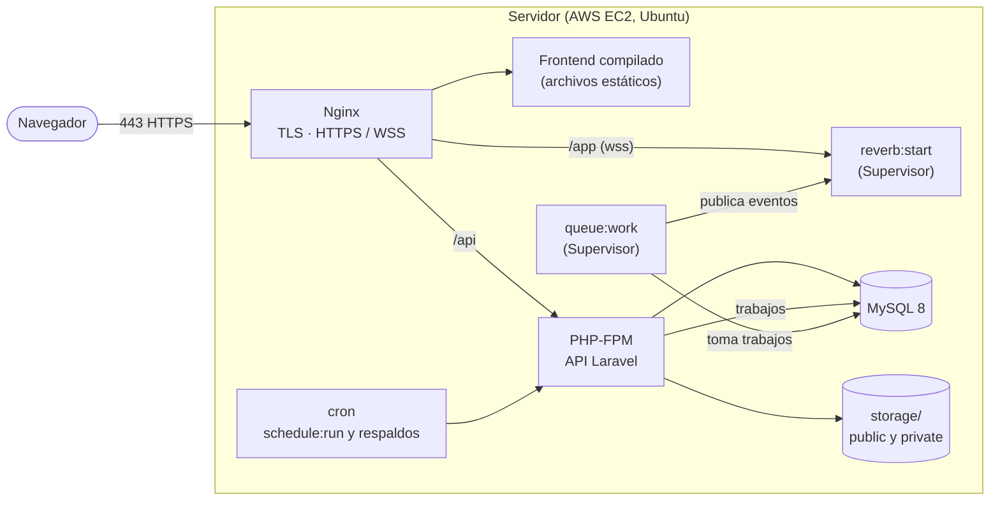
