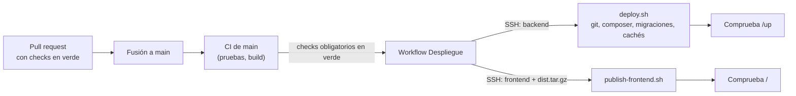

# Despliegue y operación

Cómo está puesta en producción Maestros a un clic, cómo se actualiza sola desde GitHub y cómo se opera. La topología está en [03-diagramas.md §8](03-diagramas.md#8-despliegue). Para el entorno de desarrollo, ver el README de cada repositorio.

**Producción:** <https://maestrosaunclic.northcentralus.cloudapp.azure.com>

## 1. Infraestructura

| Elemento | Valor |
|----------|-------|
| Proveedor | Microsoft Azure, suscripción *Azure for Students* (crédito educativo, sin tarjeta) |
| Servidor | Una máquina virtual Linux `maestros-vm` (Ubuntu Server 24.04 LTS, 1 GiB de RAM más 2 GB de intercambio) en la región North Central US, grupo de recursos `maestros-rg` |
| Dominio | Nombre DNS gratuito de Azure: `maestrosaunclic.northcentralus.cloudapp.azure.com` |
| HTTPS | Certificado de Let's Encrypt, renovado automáticamente por Certbot |
| Puertos abiertos | 22 (SSH con llave), 80 (redirige a HTTPS) y 443 |

Todo corre en la misma máquina, que es suficiente para el piloto y la demostración:

| Componente | Para qué |
|------------|----------|
| Nginx | HTTPS, archivos del frontend, proxy de PHP y de los WebSockets |
| PHP-FPM 8.3 | API Laravel |
| MySQL 8 | Base de datos, ajustada a poca memoria |
| Supervisor | Mantiene vivos la cola (`queue:work`) y Reverb (`reverb:start`) |
| cron | `schedule:run` cada minuto |

**Un solo dominio.** El frontend está en `/`; el API en `/api`; los archivos públicos en `/storage`; la salud en `/up`; y Reverb en `/app` (WebSockets del navegador) y `/apps` (Laravel publica los eventos). Como todo comparte origen, el navegador no hace peticiones entre dominios y CORS no interviene.

## 2. Despliegue continuo desde GitHub



Cada repositorio tiene el workflow **Despliegue** (`.github/workflows/deploy.yml`). Cuando el CI de `main` termina, revisa que hayan pasado los checks obligatorios y publica:

- **Backend:** el workflow entra por SSH y ejecuta `deploy/deploy.sh`. El script:
  1. pone la aplicación en mantenimiento;
  2. trae `main`;
  3. ejecuta `composer install --no-dev`, las migraciones y el cacheo de configuración, rutas y eventos;
  4. reinicia la cola, Reverb y PHP-FPM;
  5. levanta la aplicación, aunque algo haya fallado.
- **Frontend:** compila en GitHub con las variables de producción y envía `dist/` comprimido al servidor. `deploy/publish-frontend.sh` publica primero los archivos nuevos y al final `index.html`, así la aplicación nunca queda en blanco.

La auditoría de dependencias no bloquea el despliegue, igual que no bloquea los PRs. Un despliegue espera a que termine el anterior. Los dos workflows se pueden lanzar a mano desde *Actions → Despliegue → Run workflow*.

**Seguridad del despliegue.** GitHub usa una llave SSH propia (`DEPLOY_SSH_KEY`). En el servidor, esa llave tiene un **comando forzado** (`deploy/ssh-gate.sh`): solo puede pedir `backend` o `frontend`. No abre una terminal, así que si se filtrara, solo serviría para volver a desplegar `main`.

Configuración de cada repositorio (*Settings → Secrets and variables → Actions*):

| Nombre | Tipo | Valor |
|--------|------|-------|
| `DEPLOY_SSH_KEY` | Secret | Llave privada de despliegue |
| `DEPLOY_KNOWN_HOSTS` | Secret | Huella del servidor (`ssh-keyscan <host>`) |
| `DEPLOY_HOST` | Variable | `maestrosaunclic.northcentralus.cloudapp.azure.com` |
| `DEPLOY_USER` | Variable | `maestros` |
| `VITE_REVERB_APP_KEY` | Variable (solo frontend) | La `REVERB_APP_KEY` del `.env` del servidor. Es pública: va en el JavaScript |

Si `DEPLOY_HOST` no existe, el workflow se salta sin fallar.

## 3. Preparar un servidor nuevo

`deploy/provision.sh` deja lista una máquina Ubuntu 24.04 limpia en unos 10 minutos:

```bash
ssh maestros@<host>
sudo git clone https://github.com/LordCasta/maestros_a_un_clic_backend.git /var/www/maestros-backend
sudo DOMAIN=<host> EMAIL=<correo> \
     REVERB_APP_KEY=$(openssl rand -hex 16) REVERB_APP_SECRET=$(openssl rand -hex 32) \
     DEPLOY_PUBKEY="ssh-ed25519 AAAA… github-actions" SEED_DEMO=1 \
     bash /var/www/maestros-backend/deploy/provision.sh
```

Qué hace el script:

1. Crea 2 GB de intercambio y luego instala Nginx, PHP 8.3, MySQL, Supervisor, Certbot y Composer.
2. Ajusta MySQL y PHP-FPM a poca memoria y crea la base de datos `maestros` con un usuario propio y una contraseña aleatoria.
3. Genera el `.env` de producción (tabla siguiente).
4. Corre las migraciones y carga las comunas y las categorías.
5. Con `SEED_DEMO=1`, carga los datos de demostración y les pone una contraseña aleatoria. Con una URL pública, `password` sería una puerta abierta. El script imprime la contraseña al final.
6. Configura Nginx, el certificado HTTPS, Supervisor y cron.
7. Instala la llave de despliegue con su comando forzado.

`artisan` siempre corre como `www-data`, el usuario de PHP-FPM, para que los logs y la caché queden con un dueño que pueda escribirlos.

Variables del `.env` de producción:

| Variable | Valor |
|----------|-------|
| `APP_ENV` / `APP_DEBUG` | `production` / `false` |
| `APP_URL` / `FRONTEND_URL` | `https://<host>`. El mismo dominio para las URLs de archivos y para el enlace de recuperación de contraseña |
| `APP_KEY` | Aleatoria, generada al preparar el servidor |
| `DB_*` | Base `maestros` y usuario `maestros`, con permisos solo sobre ella |
| `LOG_STACK` / `LOG_LEVEL` | `daily` / `warning` |
| `REVERB_APP_KEY` / `REVERB_APP_SECRET` | Propias de producción, no las de desarrollo |
| `REVERB_HOST` / `REVERB_PORT` / `REVERB_SCHEME` | `<host>` / `443` / `https`: lo que ve el navegador |
| `REVERB_SERVER_HOST` / `REVERB_SERVER_PORT` | `127.0.0.1` / `8080`: donde escucha Reverb, detrás de Nginx |
| `MAIL_MAILER` | `log` por ahora. Para que lleguen los correos de recuperación hay que configurar un SMTP (por ejemplo, Brevo tiene un plan gratuito) |

## 4. Operación

| Tarea | Cómo |
|-------|------|
| Entrar al servidor | `ssh -i ~/.ssh/maestros_azure maestros@<host>` |
| Desplegar a mano | En el servidor: `bash /var/www/maestros-backend/deploy/deploy.sh`. Desde GitHub: *Actions → Despliegue → Run workflow* |
| Estado de la cola y Reverb | `sudo supervisorctl status` |
| Logs de la aplicación | `/var/www/maestros-backend/storage/logs/laravel-AAAA-MM-DD.log` |
| Logs de la cola y Reverb | `/var/log/maestros/queue.log` y `/var/log/maestros/reverb.log` |
| Trabajos fallidos | `sudo -u www-data php artisan queue:failed` y `queue:retry all` |
| Renovación del certificado | Automática (`certbot.timer`). Prueba: `sudo certbot renew --dry-run` |
| Detener la máquina para ahorrar crédito | Desde el portal de Azure, *Detener*. La IP y el nombre DNS se conservan. Al encenderla, los servicios arrancan solos |

## 5. Respaldos y restauración

| Qué | Cómo | Frecuencia | Retención |
|-----|------|------------|-----------|
| Base de datos | `mysqldump --single-transaction maestros > backup-$(date +%F).sql`, comprimido | Diario (cron) | 7 días en el servidor y una copia fuera de él |
| Archivos | `storage/app/public` y `storage/app/private` (portafolio, avatares, documentos y adjuntos) | Diario | 7 días |

**Restaurar:** `mysql maestros < backup-AAAA-MM-DD.sql` y copiar de vuelta las carpetas de `storage/app`. Conviene probar una restauración al menos una vez antes del lanzamiento.

## 6. Monitoreo

- **Salud:** `GET https://<host>/up` responde 200 si la aplicación arranca. El despliegue lo comprueba al terminar. Para el uso continuo, conviene un monitor externo gratuito que lo consulte cada 5 minutos (RNF-DIS-01).
- **Errores:** logs diarios de Laravel (sección 4).
- **Tiempo real:** si las notificaciones no llegan, revisa `supervisorctl status` y el log de Reverb.

## 7. Lista de verificación antes de abrir a usuarios reales

- [x] `APP_DEBUG=false` y `APP_ENV=production`.
- [x] HTTPS activo; WebSockets por `wss`.
- [x] Frontend y API en el mismo origen (CORS no interviene).
- [x] Claves de Reverb y de la aplicación propias, no las de desarrollo.
- [x] Usuario de MySQL con permisos solo sobre su base.
- [x] Contraseñas de las cuentas demo cambiadas por una aleatoria.
- [ ] Respaldos programados y una restauración probada.
- [ ] Monitor externo de `/up`.
- [ ] SMTP para los correos de recuperación de contraseña.
- [ ] Vencimiento de los tokens (`sanctum.expiration`) y límite del chat (E-22 del [informe 09](09-informe-analisis-funcional.md)).
- [ ] Política de tratamiento de datos publicada y aceptada en el registro (RNF-PRI-03).
- [ ] Datos de maqueta retirados de los paneles (E-11).
