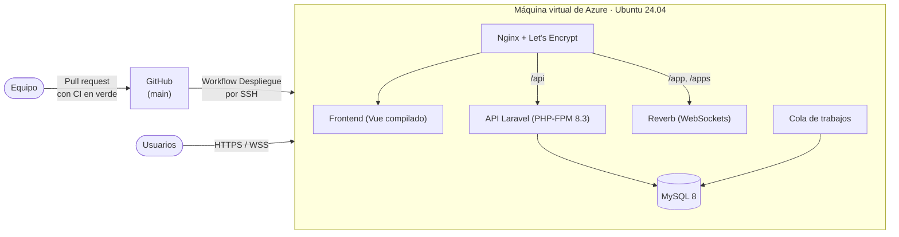
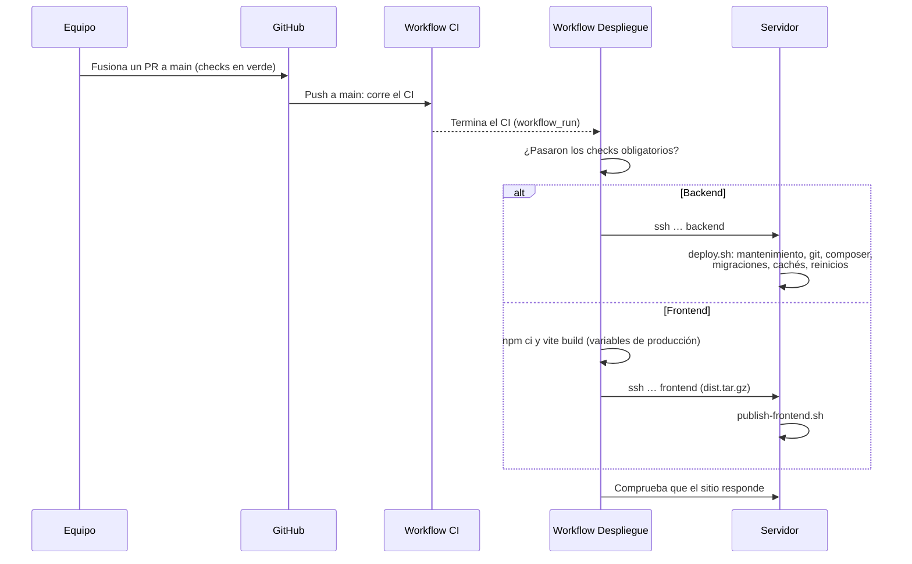

# Guía de despliegue en Azure

Paso a paso exacto de cómo se puso Maestros a un clic en producción, en el orden en que se hizo, para poder repetirlo:

1. crear la máquina virtual en Azure;
2. prepararla con un solo script;
3. conectarla con GitHub;
4. dejarla desplegando sola cada vez que se fusiona a `main`.

El resultado está en **<https://maestrosaunclic.northcentralus.cloudapp.azure.com>**.

La referencia de operación (variables, respaldos, monitoreo) está en [06-despliegue-y-operacion.md](06-despliegue-y-operacion.md). Esta guía se centra en **cómo se llega ahí**.

## 1. Qué se construye



- **Una sola máquina** con todo adentro: suficiente para la demostración y gratuita con *Azure for Students*.
- **Un solo dominio:** el que Azure da gratis, con HTTPS. El frontend, el API y los WebSockets comparten origen, así que no hay CORS que configurar.
- **Despliegue continuo:** cuando el CI de `main` pasa, GitHub Actions publica la nueva versión. Nadie tiene que entrar al servidor.

| Dato | Valor |
|------|-------|
| Suscripción | Azure for Students (100 USD de crédito, sin tarjeta) |
| Grupo de recursos | `maestros-vm_grupo` |
| Máquina virtual | `maestros-vm`, tamaño **Standard_B2ats_v2** (2 vCPU, 1 GiB de RAM) |
| Región | North Central US |
| Imagen | Ubuntu Server 24.04 LTS (x64 Gen2) |
| Disco | SSD Premium de 64 GiB |
| IP pública | `20.80.51.83` (estática) |
| Nombre DNS | `maestrosaunclic.northcentralus.cloudapp.azure.com` |
| Usuario SSH | `maestros` |
| Software instalado | Nginx 1.24, PHP 8.3, MySQL 8.0, Supervisor 4.2, Certbot 2.9, Composer 2 |

## 2. Requisitos previos

- Una cuenta de **Azure for Students** activa (<https://azure.microsoft.com/free/students>), creada con el correo institucional.
- Permisos de administrador en los dos repositorios de GitHub, para crear *secrets* y variables.
- En el computador: **Git Bash** (trae `ssh`, `ssh-keygen` y `scp`), **Node.js 24** y, opcionalmente, la CLI de GitHub (`gh`).

## 3. Paso 1: crear las llaves SSH

Se crean **dos** pares de llaves en el computador, en Git Bash:

```bash
ssh-keygen -t ed25519 -f ~/.ssh/maestros_azure  -N "" -C "juan-pc@maestros-azure"
ssh-keygen -t ed25519 -f ~/.ssh/maestros_deploy -N "" -C "github-actions@maestros-deploy"
cat ~/.ssh/maestros_azure.pub      # esta línea se pega en el portal de Azure
```

| Llave | Para qué | Dónde queda la parte privada |
|-------|----------|------------------------------|
| `maestros_azure` | Entrar al servidor como administrador | Solo en el computador del equipo |
| `maestros_deploy` | Que GitHub Actions despliegue | En los *secrets* de GitHub. En el servidor **solo puede desplegar** (sección 11) |

Se separan para poder revocar la de GitHub sin perder el acceso de administrador. Las llaves privadas nunca se suben a un repositorio ni se envían por chat.

## 4. Paso 2: crear la máquina virtual en el portal

En <https://portal.azure.com>: **Máquinas virtuales → Crear → Máquina virtual de Azure**.

**Pestaña Aspectos básicos:**

| Campo | Valor |
|-------|-------|
| Suscripción | Azure for Students |
| Grupo de recursos | *Crear nuevo*: `maestros-vm_grupo` (es el que propone el portal) |
| Nombre de la máquina virtual | `maestros-vm` |
| Región | **(US) North Central US**. Azure for Students no permite todas las regiones; si una da un error de política (*"not allowed"*), se elige otra |
| Opciones de disponibilidad | No se requiere redundancia de infraestructura |
| Tipo de seguridad | Estándar |
| Imagen | **Ubuntu Server 24.04 LTS - x64 Gen2** |
| Tamaño | **Standard_B2ats_v2** (2 vCPU, 1 GiB). Debe decir *"Free services eligible"*. También sirve Standard_B1s |
| Tipo de autenticación | Clave pública SSH |
| Nombre de usuario | `maestros` |
| Origen de clave pública SSH | *Usar clave pública existente*: se pega la línea completa de `maestros_azure.pub` |
| Puertos de entrada públicos | Permitir los seleccionados: **HTTP (80), HTTPS (443) y SSH (22)** |

**Pestaña Discos:** disco del sistema operativo **SSD Premium de 64 GiB (P6)**, que entra en los servicios gratuitos de 12 meses.

**Pestaña Redes:** todo por defecto. Se marca *"Eliminar la IP pública y la NIC cuando se elimine la VM"*.

**Revisar y crear → Crear.** Tarda unos dos minutos.

## 5. Paso 3: ponerle un nombre DNS

El certificado HTTPS necesita un nombre, no solo una IP. Azure da uno gratis: **no hay que crear una zona DNS**, que sirve para dominios propios y además tiene costo.

1. Abrir la máquina virtual, en **Información general**.
2. En **Nombre DNS**, que dice *"No configurado"*, hacer clic en el enlace. Otra forma: clic en la IP pública y luego, en el menú, **Configuración**.
3. En **Etiqueta de nombre DNS**, escribir `maestrosaunclic`. El nombre completo queda así: `maestrosaunclic.northcentralus.cloudapp.azure.com`.
4. Revisar que la **asignación** de la IP sea **Estática**, para que no cambie al reiniciar.
5. **Guardar.**

## 6. Paso 4: comprobar el acceso

```bash
nslookup maestrosaunclic.northcentralus.cloudapp.azure.com     # debe responder 20.80.51.83
ssh -i ~/.ssh/maestros_azure maestros@maestrosaunclic.northcentralus.cloudapp.azure.com
```

La primera vez, SSH pregunta si se confía en el servidor: se responde `yes`. Si entra y muestra la consola de Ubuntu, el paso está listo.

## 7. Paso 5: preparar el servidor con `provision.sh`

Todo lo que el servidor necesita lo hace un solo script del repositorio: [`deploy/provision.sh`](../../deploy/provision.sh). Desde el computador:

```bash
H=maestrosaunclic.northcentralus.cloudapp.azure.com
ssh -i ~/.ssh/maestros_azure maestros@$H
```

Ya dentro del servidor:

```bash
sudo git clone https://github.com/LordCasta/maestros_a_un_clic_backend.git /var/www/maestros-backend

sudo DOMAIN=maestrosaunclic.northcentralus.cloudapp.azure.com \
     EMAIL=<correo para avisos del certificado> \
     REVERB_APP_KEY=$(openssl rand -hex 16) \
     REVERB_APP_SECRET=$(openssl rand -hex 32) \
     DEPLOY_PUBKEY="<contenido de ~/.ssh/maestros_deploy.pub>" \
     SEED_DEMO=1 \
     bash /var/www/maestros-backend/deploy/provision.sh
```

> Hay que **anotar el `REVERB_APP_KEY`** que se use, porque GitHub lo necesita para compilar el frontend (paso 6). También queda guardado en el `.env` del servidor.

Tarda unos 10 minutos. El script hace, en orden:

| # | Paso | Detalle |
|---|------|---------|
| 1 | Memoria de intercambio | 2 GB de *swap*, porque la máquina tiene 1 GiB de RAM |
| 2 | Paquetes | Nginx, MySQL, PHP 8.3 con sus extensiones, Supervisor, Certbot, Git, rsync y Composer |
| 3 | MySQL | Ajustado a poca memoria. Crea la base `maestros` y su usuario, con una contraseña aleatoria |
| 4 | PHP-FPM | Pocos procesos, y límites de carga para los documentos de verificación |
| 5 | Código | El backend en `/var/www/maestros-backend` y una página provisional en `/var/www/maestros-frontend` |
| 6 | `.env` de producción | `APP_DEBUG=false`, la URL con HTTPS, claves propias de la app y de Reverb, logs diarios |
| 7 | Base de datos | Migraciones, las 21 comunas y corregimientos, y las categorías |
| 8 | Datos demo (`SEED_DEMO=1`) | Las cuentas de demostración con una **contraseña aleatoria**: en una URL pública, `password` sería una puerta abierta |
| 9 | Nginx | Configuración de [`deploy/nginx.conf`](../../deploy/nginx.conf): frontend, API y Reverb en el mismo dominio |
| 10 | HTTPS | Certificado de Let's Encrypt, con redirección de HTTP a HTTPS y renovación automática |
| 11 | Procesos permanentes | Supervisor mantiene vivos la cola y Reverb. cron ejecuta las tareas programadas |
| 12 | Llave de despliegue | Se autoriza la llave de GitHub **solo** para desplegar (sección 11) |

Al final imprime la dirección de la aplicación y, si se cargó la demo, la contraseña de las cuentas demo. Esa contraseña también queda en el servidor, en `~/demo-password.txt`, para consultarla después.

## 8. Paso 6: configurar GitHub

En **cada** repositorio, backend y frontend: **Settings → Secrets and variables → Actions**.

| Nombre | Pestaña | Valor | Repositorio |
|--------|---------|-------|-------------|
| `DEPLOY_SSH_KEY` | Secrets | Todo el contenido de `~/.ssh/maestros_deploy` (la llave **privada**) | Los dos |
| `DEPLOY_KNOWN_HOSTS` | Secrets | La salida de `ssh-keyscan maestrosaunclic.northcentralus.cloudapp.azure.com` | Los dos |
| `DEPLOY_HOST` | Variables | `maestrosaunclic.northcentralus.cloudapp.azure.com` | Los dos |
| `DEPLOY_USER` | Variables | `maestros` | Los dos |
| `VITE_REVERB_APP_KEY` | Variables | El `REVERB_APP_KEY` del paso 5 | Solo frontend |

Con la CLI de GitHub es lo mismo en una sola tanda, desde Git Bash:

```bash
H=maestrosaunclic.northcentralus.cloudapp.azure.com
ssh-keyscan $H > known_hosts_prod
for R in LordCasta/maestros_a_un_clic_backend LordCasta/maestros_a_un_clic_frontend; do
  gh secret set DEPLOY_SSH_KEY     -R $R < ~/.ssh/maestros_deploy
  gh secret set DEPLOY_KNOWN_HOSTS -R $R < known_hosts_prod
  gh variable set DEPLOY_HOST      -R $R --body "$H"
  gh variable set DEPLOY_USER      -R $R --body maestros
done
gh variable set VITE_REVERB_APP_KEY -R LordCasta/maestros_a_un_clic_frontend --body "<REVERB_APP_KEY>"
rm known_hosts_prod
```

**`DEPLOY_KNOWN_HOSTS` es la huella del servidor.** Con ella, GitHub comprueba que se conecta a la máquina correcta y no a una impostora. Si la máquina se vuelve a crear, cambia su huella y hay que actualizar este *secret*.

## 9. Paso 7: el primer despliegue

El servidor quedó con el backend, pero con una página provisional en lugar del frontend. El primer despliegue se puede hacer de dos formas:

- **Automático:** con los workflows ya en `main` (sección 10), en *Actions → Despliegue → Run workflow*, en cada repositorio.
- **A mano**, desde el computador, con la misma llave que usa GitHub. Así se hizo la primera vez:

```bash
H=maestrosaunclic.northcentralus.cloudapp.azure.com
cd frontend-maestros-a-un-clic
VITE_API_BASE_URL=https://$H/api/v1 VITE_REVERB_APP_KEY=<REVERB_APP_KEY> \
VITE_REVERB_HOST=$H VITE_REVERB_PORT=443 VITE_REVERB_SCHEME=https \
  npx vite build
tar -czf - -C dist . | ssh -i ~/.ssh/maestros_deploy maestros@$H frontend   # publica el frontend
ssh -i ~/.ssh/maestros_deploy maestros@$H backend                            # despliega el backend
```

**Verificación** (la que se hizo el 24 de octubre de 2026):

| Prueba | Resultado |
|--------|-----------|
| `https://<host>/up`, `/api/v1/categories` y `/` | 200, con certificado válido |
| Login con una cuenta demo y la contraseña `password` | 401: rechazada |
| Login con la contraseña aleatoria, por la pantalla, en Chrome | Entra al panel del cliente |
| WebSockets | Se conectan por `wss://` y los canales privados se autorizan |
| El cliente envía un mensaje del chat | Le llega al profesional en vivo, sin recargar |
| La llave de despliegue intenta otro comando (`whoami`) | Rechazado: *"Comando no permitido"* |

## 10. Cómo despliega solo desde GitHub

Cada repositorio tiene el workflow **Despliegue** (`.github/workflows/deploy.yml`).



**Cuándo despliega:**

- **Solo después de un push a `main`**, es decir, cuando se fusiona un PR. Nunca con un PR abierto.
- **Solo si pasaron los checks obligatorios del CI.**
  - Backend: `Tests (PHP 8.2)` y `Tests (PHP 8.5)`.
  - Frontend: `Lint, tipos, tests y build`.
  - La auditoría de dependencias no cuenta: puede fallar por un aviso nuevo sin bloquear, igual que en los PRs.
- **Uno a la vez.** Si llegan dos fusiones seguidas, la segunda espera a que termine la primera.
- **Solo si existe `DEPLOY_HOST`.** Sin servidor configurado, el workflow se salta sin fallar.

**Qué hace en el servidor el despliegue del backend** ([`deploy/deploy.sh`](../../deploy/deploy.sh)):

1. Pone la aplicación en mantenimiento (`artisan down`).
2. Trae exactamente lo que hay en `main` (`git fetch` y `git reset --hard origin/main`).
3. Instala las dependencias de producción (`composer install --no-dev`).
4. Aplica las migraciones nuevas. Nunca se editan las existentes, así que no se pierden datos.
5. Regenera las cachés de configuración, rutas y eventos.
6. Reinicia la cola y Reverb, y recarga PHP-FPM, para que todo use el código nuevo.
7. Levanta la aplicación (`artisan up`), **aunque algún paso haya fallado**.

**Qué hace el despliegue del frontend:**

1. GitHub compila `dist/` con las variables de producción.
2. GitHub lo envía comprimido.
3. [`deploy/publish-frontend.sh`](../../deploy/publish-frontend.sh) copia primero los archivos nuevos y al final `index.html`, así la aplicación nunca queda en blanco. Si el paquete no trae `index.html`, no publica nada.

**Dónde verlo:** en GitHub, pestaña **Actions → Despliegue**. Cada ejecución muestra qué checks revisó, la salida del servidor (por ejemplo, *"Desplegado 254e97f: …"*) y la comprobación final. La ejecución queda en verde si el sitio responde.

**Desplegar a mano** (por ejemplo, después de cambiar una variable): *Actions → Despliegue → Run workflow*.

**Volver a una versión anterior:** se revierte el PR en GitHub (*Revert*), y esa reversión, al fusionarse, se despliega como cualquier otra.

> **Estado al 24 de octubre de 2026.** Los *secrets*, las variables y el servidor ya están listos. Los dos workflows esperan su revisión en el backend #85 y el frontend #31. Tocan `.github/`, así que necesitan la etiqueta `cambio-de-reglas`, que pone una persona. Desde que se fusionen, cada fusión a `main` llega sola a producción.

## 11. Seguridad del montaje

- **La llave de GitHub no abre una terminal.** En el servidor, su línea de `~/.ssh/authorized_keys` tiene un comando forzado ([`deploy/ssh-gate.sh`](../../deploy/ssh-gate.sh)): solo acepta `backend` o `frontend`. Si se filtrara, solo serviría para volver a desplegar `main`. Cualquier otra cosa responde *"Comando no permitido"*.
- **Mínimos privilegios en el servidor.** `deploy.sh` corre con el usuario `maestros`, y solo puede ejecutar como administrador tres reinicios concretos (`/etc/sudoers.d/maestros-deploy`). Los comandos de Laravel corren como `www-data`, el mismo usuario de PHP.
- **Secretos fuera del código.** Las contraseñas de MySQL y de la demo, las claves de la app y de Reverb, y la llave privada viven en el `.env` del servidor o en los *secrets* de GitHub. Nunca están en el repositorio.
- **Solo tres puertos abiertos:** 22 con llave (sin contraseña), 80 (redirige) y 443.
- **Producción sin modo de depuración.** `APP_DEBUG=false`: los errores no muestran código ni datos.

## 12. Costos y cuidado del crédito

- **Lo gratuito de Azure for Students:** el portal marcó la máquina y el disco como *"Free services eligible"*, es decir, dentro de los servicios gratuitos de 12 meses (del orden de 750 horas al mes de máquina pequeña). Lo que exceda esa cuota se descuenta de los 100 USD de crédito. La lista exacta está en el portal, en *Servicios gratuitos*.
- **Sin cobros sorpresa:** la suscripción no tiene tarjeta. Si el crédito se acaba, los servicios se detienen.
- **Detener la máquina** desde el portal cuando no se use. Se conservan la IP, el nombre DNS y los datos, y al encenderla todo arranca solo: Nginx, MySQL, PHP, Supervisor y la renovación del certificado.
- **Consultar el gasto:** en el portal, *Suscripciones → Azure for Students → Análisis de costos*, o en el centro *Education*, que muestra el crédito restante.

## 13. Solución de problemas

| Síntoma | Causa probable | Qué hacer |
|---------|----------------|-----------|
| Al crear la VM: error de política o *"not allowed"* | Azure for Students limita las regiones | Elegir otra región, como se hizo con North Central US |
| El portal pide crear una "zona DNS" | Es otra cosa: un dominio propio | Usar la **etiqueta de nombre DNS** de la IP pública (paso 3) |
| `ssh: Permission denied (publickey)` | Se usó otra llave u otro usuario | `ssh -i ~/.ssh/maestros_azure maestros@<host>` |
| El despliegue falla con *Host key verification failed* | La VM se volvió a crear y cambió su huella | Actualizar `DEPLOY_KNOWN_HOSTS` con `ssh-keyscan` (paso 6) |
| El despliegue dice *"Comando no permitido"* | Algo intentó usar la llave de GitHub para otra cosa | Es lo esperado: solo acepta `backend` o `frontend` |
| El workflow aparece como *skipped* | Falta `DEPLOY_HOST`, el CI no pasó o fue un PR | Revisar las variables y el CI de `main` |
| El sitio muestra 502 | PHP-FPM caído | `sudo systemctl restart php8.3-fpm` |
| No llegan los mensajes en vivo | Reverb detenido | `sudo supervisorctl status` y `sudo supervisorctl restart maestros-reverb`. Log: `/var/log/maestros/reverb.log` |
| Errores 500 | Ver el detalle en el log | `/var/www/maestros-backend/storage/logs/laravel-AAAA-MM-DD.log` |
| `provision.sh` falla en el certificado | El nombre DNS aún no apunta a la IP, o el puerto 80 está cerrado | Comprobar con `nslookup` y la regla del puerto 80, y volver a correr el script. Es seguro repetirlo |
| La máquina se queda sin memoria | 1 GiB es justo | El *swap* de 2 GB lo absorbe. Si pasa seguido, subir de tamaño desde el portal |
